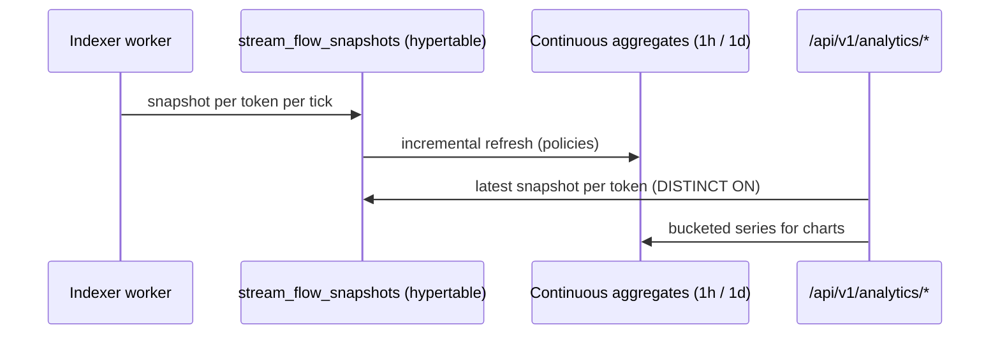

# Analytics — TimescaleDB TVL & velocity (#1480)

Protocol TVL, uncollected claims and streaming velocity change every second,
so they are **snapshotted into a hypertable** and pre-aggregated with
continuous aggregates instead of being recomputed from raw tables on every
request.

## Pipeline



## Endpoints

| Endpoint | Purpose |
|---|---|
| `GET /api/v1/analytics/tvl` | Current TVL partitioned by token (`source: timescaledb \| live`) |
| `GET /api/v1/analytics/historical?period=30d&interval=1d` | `7d/30d/90d/1y` × `1h/1d` chart series |
| `GET /api/v1/analytics/defillama` | DefiLlama adapter payload |

## Time-window and timezone semantics (#61)

Analytics aggregates are **reproducible**: the same query issued at the same
logical time returns the same buckets regardless of the caller's timezone or
the server's local timezone.

### UTC boundaries

- All window boundaries are computed in **UTC**. The server's `TZ` and the
  client's timezone never influence bucket edges.
- A relative `period` (`7d`, `30d`, `90d`, `1y`) is resolved against the
  current UTC instant, truncated to the bucket interval. For example, with
  `interval=1d` the window ends at the start of the current UTC day and the
  first bucket starts at `now_utc - period` truncated to a UTC day boundary.
- Bucket timestamps in responses are ISO-8601 with an explicit `Z` suffix.

### Half-open buckets

- Every bucket is **half-open**: `[start, end)`. An event whose timestamp is
  exactly on a bucket boundary belongs to the bucket that starts at that
  timestamp, never to the preceding one.
- The overall window is likewise half-open: `[windowStart, windowEnd)`. An
  event exactly at `windowEnd` is excluded; an event exactly at `windowStart`
  is included.
- Buckets are contiguous and non-overlapping; there are no gaps between
  adjacent buckets.

### Late-arriving indexed events

- Indexed events may be written after a query has already been served (chain
  reorgs, backfill, delayed indexing). Aggregates incorporate such events on
  the **next** query once they are indexed and the continuous aggregate has
  been refreshed.
- Because buckets are keyed by the event's own timestamp (not by ingestion
  time), a late event lands in its correct historical bucket. Re-running the
  same query after the event is indexed yields the updated, still-reproducible
  aggregate.
- Continuous-aggregate refresh policies run on a schedule; the maximum delay
  before a late event is visible is the refresh interval (see
  [Caching contract](#caching-contract-62) for the staleness window).

### Network scoping

- Every aggregate is scoped to a single **network**. The network is a required
  dimension of the query and of the cache key; results for one network are
  never mixed with or leaked into another.
- When no network is supplied, the request is rejected rather than defaulting
  to a global aggregate, so cross-network contamination is impossible.

## Caching contract (#62)

Aggregate endpoints are served through a bounded in-process cache to avoid
recomputing expensive continuous-aggregate queries on every request.

### Cache key dimensions

A cache entry is uniquely identified by:

1. **Network** — the scoped network id.
2. **Time range** — the resolved UTC `[windowStart, windowEnd)` plus the
   bucket `interval`.
3. **Filters** — any token/asset filters applied to the query.

The key never includes user identity, so entries are shared across callers
**only within the same network and identical range/filters**. Keys are
namespaced by network, so a key for one network can never resolve to another
network's data.

### Staleness window

- Entries have a bounded TTL (the documented staleness window). Within the
  TTL, a repeated identical query is served from cache; after the TTL it is
  recomputed.
- The TTL is chosen to be no longer than the continuous-aggregate refresh
  interval, so cached results never lag the underlying aggregates by more than
  one refresh cycle.

### Invalidation on new indexed events

- When the indexer records newly indexed events (or a continuous-aggregate
  refresh completes), the affected network's cache entries are invalidated so
  the next query reflects the new data immediately rather than waiting for the
  TTL.
- Invalidation is scoped to the network whose data changed; other networks'
  entries are untouched.

## Operational and rollout impact

- **No public interface change.** Endpoint paths, query parameters and
  response shapes are unchanged; the timezone/bucket and caching semantics are
  refinements of existing behavior.
- **Timezone independence.** Deployments no longer need a specific server
  `TZ`; operators should not rely on local-time bucket edges.
- **Cache sizing.** The cache is bounded; under high-cardinality filter usage
  older entries are evicted. No configuration is required, but operators may
  tune the bound and TTL via environment settings if exposed.
- **Staleness.** Clients may observe up to one TTL of staleness for a given
  network/range/filter combination when no new events arrive; new indexed
  events invalidate the relevant entries promptly.
- **Migration.** No schema migration is required. Existing continuous
  aggregates continue to be used; only query boundary computation and the
  caching layer change.

## Asynchronous statement exports (#238)

Large activity and payment statements are generated as **bounded background
jobs** instead of being streamed from a long-lived HTTP request. Clients
create a job, poll its status, and download the finished artifact; they may
also cancel it.

### Lifecycle

| Step | Endpoint | Notes |
|---|---|---|
| Create | `POST /api/v1/exports` | Returns `202` with `{ id, status, expiresAt }` |
| Status | `GET /api/v1/exports/:id` | Returns job state, progress and, when ready, `downloadUrl` |
| Download | `GET /api/v1/exports/:id/download` | Streams the artifact once `status = completed` |
| Cancel | `DELETE /api/v1/exports/:id` | Transitions a pending/running job to `cancelled` |

Job states: `pending → running → completed | failed | cancelled | expired`.

### Ownership and authorization

- Every job is bound to the **authenticated wallet** that created it. The
  owner is recorded at creation time and never derived from request
  parameters.
- Status, download and cancel requests are authorized against the job owner.
  A caller that does not own the job receives `404` (not `403`) so job ids
  cannot be probed for existence.
- Download authorization is re-checked at download time, not only at creation
  time, so a revoked session cannot fetch an artifact created earlier.

### Expiry and cleanup

- Each job has an `expiresAt` (TTL from completion, or from creation for jobs
  that never complete). Expired jobs are no longer downloadable and report
  `status = expired`.
- A background sweeper deletes expired job rows and their stored artifacts.
  Operators should monitor sweeper lag; artifacts are not retained past the
  TTL.

### Cancellation semantics

- Cancelling a `pending` job prevents it from starting.
- Cancelling a `running` job signals the worker to stop at the next page
  boundary; the job ends `cancelled` and no partial artifact is downloadable.
- Cancelling a terminal job is a no-op that returns the current state.

### Snapshot consistency and retries

- A job captures a **snapshot boundary** (a high-water mark of indexed
  events) at creation. All pages are read against that boundary, so a
  multi-page export is internally consistent even if new events are indexed
  while the job runs.
- Workers process the export in bounded pages. If a page fails transiently,
  the worker retries that page from its last committed cursor; already
  committed pages are not re-read, so retries cannot duplicate or drop rows.
- A job that exhausts its retry budget ends `failed`; the client may create a
  new job (which takes a fresh snapshot).

## Accounting-friendly wallet activity export (#239)

The wallet activity export produces a reproducible statement of stream
lifecycle and payment records suitable for accounting import.

### Column schema

| Column | Type | Units / format |
|---|---|---|
| `event_id` | string | Stable event identifier |
| `occurred_at` | ISO-8601 | **UTC**, explicit `Z` suffix |
| `event_type` | enum | `stream_created`, `stream_cancelled`, `stream_completed`, `payment` |
| `stream_id` | string | Stream reference |
| `network` | string | Network identifier the event belongs to |
| `tx_hash` | string | Transaction reference (chain hash) |
| `tx_index` | integer | Log index within the transaction |
| `token` | string | Token/asset identifier |
| `amount_raw` | string | Integer base units, **no decimals applied** |
| `decimals` | integer | Decimals for `token`; apply to `amount_raw` to get display units |
| `amount_display` | string | `amount_raw` scaled by `decimals` (decimal string) |

### Units and timezone rules

- Amounts are exported in **raw base units** with an explicit `decimals`
  column; consumers must not assume a fixed number of decimals. The
  `amount_display` column is provided for convenience and is a decimal string,
  never a float.
- All timestamps are **UTC** with an explicit `Z` suffix; no local-time
  conversion is performed server-side.
- Every row carries its `network` and `tx_hash`/`tx_index` so records can be
  reconciled against the chain.

### Limits and ownership

- Exports are scoped to the requesting wallet; rows for wallets the caller
  does not own are never included.
- Large result sets are bounded by the export page/row limits; requests that
  exceed the configured maximum are rejected with a cost-budget error (see
  below) rather than silently truncated.
- The export is round-trip parseable: the documented schema is stable and
  machine-readable (CSV/JSON) so a consumer can re-import it losslessly.

## Request cost budgets (#250)

Expensive read operations (analytics, exports, multi-resource queries) are
governed by a **complexity budget** in addition to per-request rate limits.

### Cost units

Each route declares a cost in abstract units; the request's total cost is
compared against the caller's budget for the window.

| Route | Cost units |
|---|---|
| `GET /api/v1/analytics/tvl` | 1 |
| `GET /api/v1/analytics/historical` | 2 |
| `GET /api/v1/analytics/defillama` | 1 |
| `POST /api/v1/exports` | 10 |
| `GET /api/v1/exports/:id` | 1 |
| `GET /api/v1/exports/:id/download` | 5 |

Cheap requests (single-resource reads, status polls) cost 1 unit and remain
unaffected by the budget under normal usage.

### Client-facing limit errors

When a request would exceed the budget, the API responds `429` with:

```json
{ "error": "COST_BUDGET_EXCEEDED", "retryAfter": 30 }
```

Clients should back off for `retryAfter` seconds before retrying.

## Operational notes

- **Worker processing.** Export jobs are processed by a bounded worker pool;
  concurrency and page size are configurable. A backlog of jobs does not
  affect interactive endpoints.
- **Expiry cleanup.** A periodic sweeper removes expired jobs and artifacts.
  Monitor job age and sweeper lag; artifacts are deleted at expiry.
- **Budgets.** Cost budgets are enforced per caller per window; tune the
  window and per-route costs via configuration if exposed.

## Degradation

If the TimescaleDB extension or the hypertable is missing, `/tvl` falls back
to live aggregation over the `Stream` table (`source: "live"`) and
`/historical` returns an empty series — stock PostgreSQL deployments keep
working, they just lose the pre-aggregation. The UTC boundary, half-open
bucket and network-scoping semantics above apply identically to the live
fallback path.