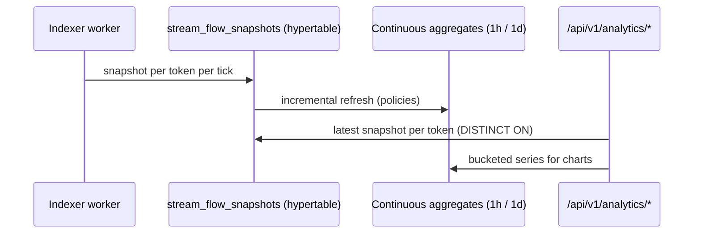

# Analytics — TimescaleDB TVL & velocity (#1480)

Protocol TVL, uncollected claims and streaming velocity change every second,
so they are **snapshotted into a hypertable** and pre-aggregated with
continuous aggregates instead of being recomputed from raw tables on every
request.

## Pipeline

## Endpoints

| Endpoint | Purpose |
|---|---|
| `GET /api/v1/analytics/tvl` | Current TVL partitioned by token (`source: timescaledb \| live`) |
| `GET /api/v1/analytics/historical?period=30d&interval=1d` | `7d/30d/90d/1y` × `1h/1d` chart series |
| `GET /api/v1/analytics/defillama` | DefiLlama adapter payload |

## Time-window and timezone semantics (#61)

Analytics aggregates are **reproducible**: the same query issued at the same
logical time returns the same buckets regardless of the caller's timezone or
the server's local timezone.

### UTC boundaries

- All window boundaries are computed in **UTC**. The server's `TZ` and the
  client's timezone never influence bucket edges.
- A relative `period` (`7d`, `30d`, `90d`, `1y`) is resolved against the
  current UTC instant, truncated to the bucket interval. For example, with
  `interval=1d` the window ends at the start of the current UTC day and the
  first bucket starts at `now_utc - period` truncated to a UTC day boundary.
- Bucket timestamps in responses are ISO-8601 with an explicit `Z` suffix.

### Half-open buckets

- Every bucket is **half-open**: `[start, end)`. An event whose timestamp is
  exactly on a bucket boundary belongs to the bucket that starts at that
  timestamp, never to the preceding one.
- The overall window is likewise half-open: `[windowStart, windowEnd)`. An
  event exactly at `windowEnd` is excluded; an event exactly at `windowStart`
  is included.
- Buckets are contiguous and non-overlapping; there are no gaps between
  adjacent buckets.

### Late-arriving indexed events

- Indexed events may be written after a query has already been served (chain
  reorgs, backfill, delayed indexing). Aggregates incorporate such events on
  the **next** query once they are indexed and the continuous aggregate has
  been refreshed.
- Because buckets are keyed by the event's own timestamp (not by ingestion
  time), a late event lands in its correct historical bucket. Re-running the
  same query after the event is indexed yields the updated, still-reproducible
  aggregate.
- Continuous-aggregate refresh policies run on a schedule; the maximum delay
  before a late event is visible is the refresh interval (see
  [Caching contract](#caching-contract-62) for the staleness window).

### Network scoping

- Every aggregate is scoped to a single **network**. The network is a required
  dimension of the query and of the cache key; results for one network are
  never mixed with or leaked into another.
- When no network is supplied, the request is rejected rather than defaulting
  to a global aggregate, so cross-network contamination is impossible.

## Caching contract (#62)

Aggregate endpoints are served through a bounded in-process cache to avoid
recomputing expensive continuous-aggregate queries on every request.

### Cache key dimensions

A cache entry is uniquely identified by:

1. **Network** — the scoped network id.
2. **Time range** — the resolved UTC `[windowStart, windowEnd)` plus the
   bucket `interval`.
3. **Filters** — any token/asset filters applied to the query.

The key never includes user identity, so entries are shared across callers
**only within the same network and identical range/filters**. Keys are
namespaced by network, so a key for one network can never resolve to another
network's data.

### Staleness window

- Entries have a bounded TTL (the documented staleness window). Within the
  TTL, a repeated identical query is served from cache; after the TTL it is
  recomputed.
- The TTL is chosen to be no longer than the continuous-aggregate refresh
  interval, so cached results never lag the underlying aggregates by more than
  one refresh cycle.

### Invalidation on new indexed events

- When the indexer records newly indexed events (or a continuous-aggregate
  refresh completes), the affected network's cache entries are invalidated so
  the next query reflects the new data immediately rather than waiting for the
  TTL.
- Invalidation is scoped to the network whose data changed; other networks'
  entries are untouched.

## Operational and rollout impact

- **No public interface change.** Endpoint paths, query parameters and
  response shapes are unchanged; the timezone/bucket and caching semantics are
  refinements of existing behavior.
- **Timezone independence.** Deployments no longer need a specific server
  `TZ`; operators should not rely on local-time bucket edges.
- **Cache sizing.** The cache is bounded; under high-cardinality filter usage
  older entries are evicted. No configuration is required, but operators may
  tune the bound and TTL via environment settings if exposed.
- **Staleness.** Clients may observe up to one TTL of staleness for a given
  network/range/filter combination when no new events arrive; new indexed
  events invalidate the relevant entries promptly.
- **Migration.** No schema migration is required. Existing continuous
  aggregates continue to be used; only query boundary computation and the
  caching layer change.

## Degradation

If the TimescaleDB extension or the hypertable is missing, `/tvl` falls back
to live aggregation over the `Stream` table (`source: "live"`) and
`/historical` returns an empty series — stock PostgreSQL deployments keep
working, they just lose the pre-aggregation. The UTC boundary, half-open
bucket and network-scoping semantics above apply identically to the live
fallback path.