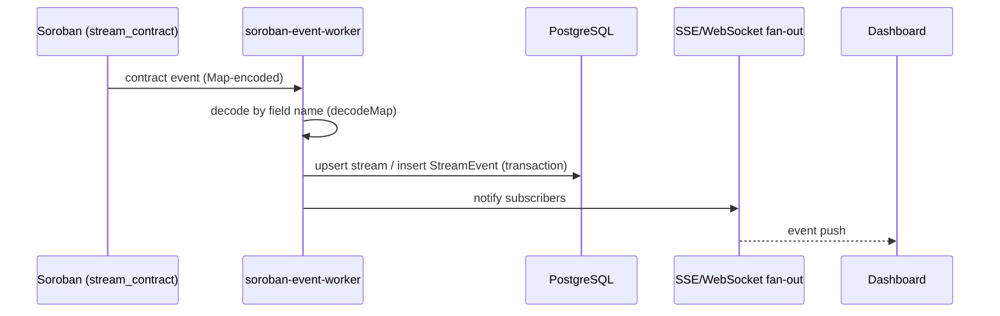

# Event ingestion

When a checkpoint no longer matches the canonical ledger, the indexer deletes
events above the last verified ledger and recomputes affected stream projections
inside one database transaction. It rewinds the cursor to that ledger with a
null event cursor, then replays canonical events. After the rollback commits,
each affected stream subscription receives `stream.reconciled` with `streamId`
and `safeLedger`. Subscribers should refetch the stream and its event list when
they receive this correction; a previously delivered event may have vanished.
Repeated canonical events remain deduplicated by their event identity.

## Contract

- Events are emitted as **Soroban Maps** keyed by field name, so decoding is
  order-independent. The pinned field/type table lives in
  `backend/tests/events-wire-format.test.ts`.
- Ingestion is **idempotent**: event identity is `(contract, topic, ledger,
  index)`, so replays are no-ops.
- The worker stores its cursor in Postgres (`INDEXER_STATE_ID`), so restarts
  resume rather than rewind.

## Failures

Decode or persistence failures land in the dead-letter table for triage —
see [dead-letter triage](/backend/dead-letter-triage).
