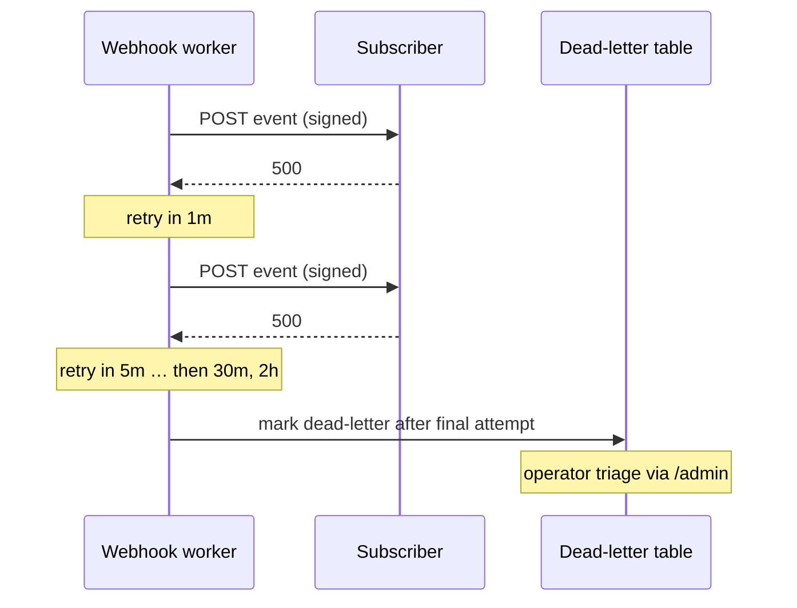

# Webhooks

Outbound webhook deliveries notify integrators when their wallet is touched
by an indexed event.

## Delivery contract

- `POST` to the subscriber's URL with an HMAC signature header
  (`X-FlowFi-Signature`) over the raw body.
- Retries use **exponential backoff** on non-2xx responses and timeouts:
  30s → 1m → 5m → 30m → 2h (six attempts), then dead-letter.



## Canonical serialization

The signature is computed over the **raw request body bytes exactly as sent**.
To make the signed bytes reproducible, the body is serialized as canonical
JSON:

- Object keys are sorted lexicographically (by Unicode code point) at every
  nesting level.
- No insignificant whitespace (no spaces, newlines, or tabs between tokens).
- Strings use standard JSON escaping; numbers use the shortest round-trippable
  representation; `null` is preserved.
- Arrays keep their original order.

Integrators should verify against the raw bytes they received, **not** against a
re-serialization of the parsed JSON. If you must re-serialize (e.g. to compare
against a stored copy), apply the same canonicalization rules above.

## Signature header format

Every delivery carries a single `X-FlowFi-Signature` header with a
comma-separated list of key/value pairs:

```
X-FlowFi-Signature: t=1700000000,v1=<hex-hmac>,kid=<key-id>
```

| Field | Meaning |
| ----- | ------- |
| `t`   | Unix timestamp (seconds) when the signature was produced. |
| `v1`  | Lowercase hex HMAC-SHA256 over `"<t>.<raw_body>"` using the subscriber secret identified by `kid`. |
| `kid` | Identifier of the signing key. Lets you select the right secret during rotation. |

The signed message is the ASCII timestamp, a literal `.`, then the raw body
bytes:

```
signed_payload = ascii(t) + "." + raw_body
v1 = hex(HMAC_SHA256(secret_for(kid), signed_payload))
```

### Verifying signatures

```python
import hmac, hashlib, time

TOLERANCE_SECONDS = 300  # 5 minutes

def parse_header(header: str) -> dict:
    parts = {}
    for pair in header.split(","):
        key, _, value = pair.strip().partition("=")
        parts[key] = value
    return parts

def verify(secret_for_kid, raw_body: bytes, header: str, now: int | None = None) -> bool:
    parts = parse_header(header)
    t = parts.get("t")
    v1 = parts.get("v1")
    kid = parts.get("kid")
    if not (t and v1 and kid):
        return False

    now = int(time.time()) if now is None else now
    if abs(now - int(t)) > TOLERANCE_SECONDS:
        return False  # expired / clock skew beyond tolerance

    secret = secret_for_kid(kid)
    if secret is None:
        return False  # unknown key id

    signed = f"{t}.".encode() + raw_body
    expected = hmac.new(secret.encode(), signed, hashlib.sha256).hexdigest()
    return hmac.compare_digest(expected, v1)
```

Always use a constant-time comparison (`hmac.compare_digest`) and reject
requests whose `t` is outside the tolerance window **before** doing any
business work.

## Timestamp tolerance

- Default tolerance is **±300 seconds (5 minutes)** around the receiver's
  clock. Requests outside this window are rejected as expired.
- Keep receiver clocks NTP-synchronized; skew larger than the tolerance will
  cause valid deliveries to be rejected.
- The tolerance is a receiver-side policy. FlowFi always signs with its own
  current time; it does not re-sign on retry, so a delivery that is retried
  after the tolerance window will be rejected by a strict receiver. Receivers
  that need to accept late retries should widen their tolerance or dedupe by
  event id (see below) rather than disabling the timestamp check.

## Replay prevention

A valid signature only proves authenticity, not freshness. To prevent replay:

1. **Enforce the timestamp tolerance** (above). This bounds the replay window.
2. **Deduplicate by event id.** Every delivery includes a stable `id` (the
   event id) and an `Idempotency-Key` header equal to that id. Record processed
   ids for at least the tolerance window (longer is safer) and ignore repeats.
3. **Treat handlers as idempotent.** Because delivery is at-least-once (see
   below), the same event may legitimately arrive more than once. Apply the
   business effect exactly once keyed by the event id.

```python
def handle(secret_for_kid, headers, raw_body, seen_ids):
    if not verify(secret_for_kid, raw_body, headers["X-FlowFi-Signature"]):
        return 401
    event = json.loads(raw_body)
    if event["id"] in seen_ids:
        return 200  # already processed; acknowledge without re-applying
    apply_event(event)
    seen_ids.add(event["id"])
    return 200
```

## Outbox delivery semantics

Delivery scheduling is written to a **transactional outbox** in the same
database transaction as the business change that produced the event. This
guarantees that a committed business change always has a deliverable event
record, even if the process crashes immediately after commit.

- **At-least-once.** Each outbox record is delivered one or more times until
  acknowledged. Use the `Idempotency-Key` / event `id` to dedupe.
- **No duplicate outbox records.** The outbox write is part of the business
  transaction and is keyed by the event id, so retries of the business
  operation do not create a second outbox row.
- **Bounded retries.** Failed attempts (non-2xx, timeout, connection error) are
  retried with exponential backoff: 30s → 1m → 5m → 30m → 2h (six attempts).
- **Durable attempt state.** Each attempt records its outcome, attempt count,
  and next-attempt time so retries survive restarts.
- **Dead-letter after max attempts.** After the final attempt the record is
  moved to the dead-letter table for operator triage via `/admin`. Dead-lettered
  events can be replayed manually.

## Key rotation

Signing keys are identified by `kid`. To rotate without breaking receivers:

1. **Publish the new key.** Add the new `kid`/secret to the receiver's
   configuration while the old key is still active. Receivers must accept any
   `kid` they know.
2. **Switch signing.** FlowFi begins signing with the new `kid`. During the
   overlap, receivers accept both old and new `kid`s.
3. **Retire the old key.** After the maximum retry window has elapsed (so no
   in-flight delivery still uses the old key), remove the old `kid` from the
   receiver configuration and from FlowFi.

Never reuse a `kid` for a different secret. Unknown `kid`s must be rejected.

## Secrets and logging

Signing secrets are **redacted from all logs**. Log lines may include the
`kid`, timestamp, and event id, but never the secret or the full `v1` value.
If you suspect a secret leaked, rotate it following the procedure above.

## Shared test vectors

These vectors use the secret `whsec_test_0123456789` with `kid=k1` and
timestamp `t=1700000000`. The signed message is `1700000000.<raw_body>`.

| Case | Raw body | Expected result |
| ---- | -------- | --------------- |
| Valid | `{"amount":"1","id":"evt_1"}` | accepted |
| Modified | `{"amount":"2","id":"evt_1"}` (body changed, header unchanged) | rejected (signature mismatch) |
| Expired | valid body, `t=1700000000`, verified at `now=1700001000` | rejected (outside ±300s) |
| Replayed | valid body, valid signature, event `id` already in `seen_ids` | acknowledged `200`, not re-applied |

Reference values for the **Valid** case (compute with the secret above):

```
signed_payload = "1700000000." + '{"amount":"1","id":"evt_1"}'
v1 = <hex HMAC-SHA256 of signed_payload with whsec_test_0123456789>
X-FlowFi-Signature: t=1700000000,v1=<v1>,kid=k1
```

The **Modified** case reuses the Valid header but sends a different body, so
`v1` no longer matches. The **Expired** case is the Valid request verified with
`now` more than 300 seconds past `t`. The **Replayed** case is the Valid
request delivered a second time; the receiver must dedupe by event id.

## Rollout and migration notes

- **Schema migration.** Adds the outbox table (event id, payload, dedupe key,
  attempt count, next-attempt time, status) and the dead-letter table. The
  migration is additive and backward compatible.
- **Backfill.** Events created before the outbox existed are backfilled into
  the outbox once, keyed by event id, so no duplicate records are created.
- **Dual-read window.** During rollout the dispatcher reads from both the
  legacy scheduling path and the outbox, deduping by event id, until the
  backfill is verified. After the window the legacy path is removed.
- **Signature compatibility.** The `t=...,v1=...,kid=...` header format is
  additive over the previous `sha256=<hex>` header. During the transition,
  deliveries include both; receivers should prefer the new format and may
  continue to accept the legacy header until the compatibility window closes.
- **Operational impact.** Delivery is at-least-once; receivers must be
  idempotent. Monitor outbox lag, retry counts, and dead-letter volume.
</｜｜DSML｜｜ parameter>