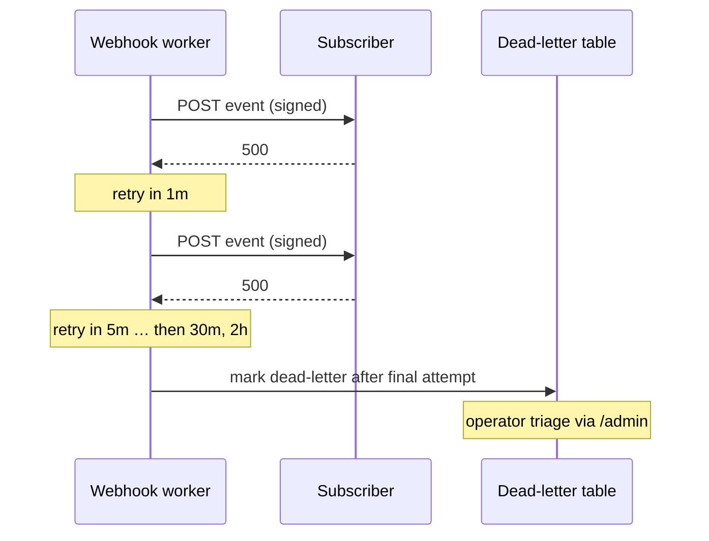

# Webhooks

Outbound webhook deliveries notify integrators when their wallet is touched
by an indexed event.

## Delivery contract

- `POST` to the subscriber's URL with an HMAC signature header
  (`X-FlowFi-Signature`) over the raw body.
- Retries use **exponential backoff** on non-2xx responses and timeouts:
  30s → 1m → 5m → 30m → 2h (six attempts), then dead-letter.



## Verifying signatures

```python
import hmac, hashlib

def verify(secret: str, raw_body: bytes, header: str) -> bool:
    expected = hmac.new(secret.encode(), raw_body, hashlib.sha256).hexdigest()
    return hmac.compare_digest(expected, header.removeprefix("sha256="))
```

## Endpoint lifecycle

Webhook endpoints are owned by the account that created them. Every
lifecycle operation is authorized against that ownership: a caller may only
create, update, disable, or delete endpoints belonging to their own account.
Requests against endpoints owned by another account are rejected as
not-found (they do not leak existence).

### Create

- `POST /webhooks` registers a new endpoint.
- The request is validated before persistence: the URL must be an absolute
  `https` URL, and the secret must be present and meet the minimum length.
  Invalid input is rejected with a validation error and nothing is stored.
- New endpoints are created in the **enabled** state and begin receiving
  deliveries immediately.

### Update

- `PATCH /webhooks/{id}` updates the URL and/or rotates the secret.
- The same validation rules as create apply. An update that fails validation
  leaves the stored endpoint unchanged.
- Rotating the secret takes effect for subsequent deliveries; in-flight
  retries for already-signed attempts are not re-signed.

### Disable

- `POST /webhooks/{id}/disable` transitions the endpoint to the **disabled**
  state.
- While disabled, the endpoint receives **no new deliveries**. Events that
  occur during the disabled window are not queued for the endpoint; they are
  not delivered retroactively when it is re-enabled.
- Disabling is idempotent: disabling an already-disabled endpoint succeeds
  without error.

### Delete

- `DELETE /webhooks/{id}` removes the endpoint.
- Deletion is idempotent from the caller's perspective: deleting an
  already-deleted endpoint returns success.
- After deletion the endpoint receives no further deliveries. Its delivery
  history remains available for audit until retention expires.

## Replay of failed deliveries

Replay re-sends previously **failed** deliveries for a single endpoint. It is
scoped and bounded by design:

- **Failed-only.** Only deliveries that ended in a failed terminal state
  (dead-lettered after exhausting retries) are eligible. Successful
  deliveries are never re-sent by replay.
- **Bounded window.** Replay accepts an explicit time window. Deliveries
  outside the window are ignored, and the number of deliveries replayed per
  request is capped. Requests exceeding the cap are rejected rather than
  silently truncated.
- **Scoped.** Replay targets exactly one endpoint owned by the caller;
  ownership checks apply as for the other lifecycle operations.
- **Rate limited.** Replay requests are subject to a per-account rate limit.
  Requests over the limit are rejected with a rate-limit error and no
  deliveries are re-sent.
- **Audit history.** Each replay request records an audit entry capturing the
  requesting account, the target endpoint, the window, and the set of
  deliveries replayed. Replayed deliveries are marked as replays in the
  delivery history so operators can distinguish them from original attempts.

## Rollout and migration notes

- New schema fields back the lifecycle and replay features: an endpoint
  `state` (enabled/disabled) and delivery records that track terminal failure
  and replay provenance.
- Existing endpoints migrate to the **enabled** state, preserving current
  delivery behavior.
- Existing delivery records are treated as non-replayable unless they are in
  a failed terminal state; successful historical deliveries are never
  eligible for replay.
- The public delivery contract (signature header, backoff schedule) is
  unchanged; lifecycle and replay are additive and do not alter existing
  endpoints' behavior until an operator uses them.