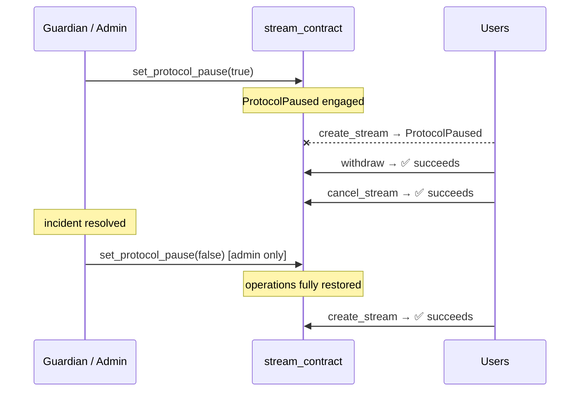

# Emergency pause & guardian

FlowFi's circuit-breaker gives protocol operators a fast, safe lever to halt
new deposits during an incident — without ever trapping funds that have already
been streamed.

## Role matrix

| Role | Granted by | Can pause | Can unpause | Other capabilities |
|---|---|---|---|---|
| **Admin** | `initialize` / `transfer_admin` | ✅ | ✅ | All admin functions |
| **Emergency guardian** | `set_emergency_guardian` (admin) | ✅ | ❌ | Pause only |
| Anyone else | — | ❌ | ❌ | — |

The asymmetry is intentional: a guardian that could also unpause could silently
reinstate deposits during the very incident that triggered the pause. By
restricting unpausing to the admin, a compromised or malfunctioning guardian key
can only ever make the protocol more restrictive, never less.

## Circuit breaker behaviour

`set_protocol_pause(caller, paused)` engages or lifts the breaker.

**While paused — token-in entrypoints revert:**

| Entrypoint | Paused behaviour |
|---|---|
| `create_stream` | ❌ `ProtocolPaused` |
| `create_step_vesting_stream` | ❌ `ProtocolPaused` |
| `create_hybrid_cliff_stream` | ❌ `ProtocolPaused` |
| `top_up_stream` | ❌ `ProtocolPaused` |

**While paused — token-out entrypoints remain open:**

| Entrypoint | Paused behaviour |
|---|---|
| `withdraw` | ✅ Succeeds — recipients can always claim vested funds |
| `batch_withdraw` | ✅ Succeeds — batch withdrawal also stays open |
| `cancel_stream` | ✅ Succeeds — senders can always reclaim unstreamed principal |

Read-only views (`get_stream`, `get_claimable_amount`, `is_protocol_paused`,
`get_fee_config`, etc.) are never affected by a pause.

## Recovery rules

An incident response follows this sequence:

1. **Trip the breaker** — admin or guardian calls `set_protocol_pause(true)`.
2. **Investigate / fix** — funds cannot enter the protocol but can always leave.
3. **Restore** — **only the admin** calls `set_protocol_pause(false)`.
4. **Normal operation resumes** — `create_stream` and all other token-in
   entrypoints become available again immediately.



## Managing the guardian

```bash
# Set a guardian
stellar contract invoke --id $CONTRACT_ID \
  --source $ADMIN_SECRET \
  -- set_emergency_guardian \
  --admin $ADMIN_ADDRESS \
  --guardian $GUARDIAN_ADDRESS

# Remove the guardian (admin becomes sole pause authority)
stellar contract invoke --id $CONTRACT_ID \
  --source $ADMIN_SECRET \
  -- set_emergency_guardian \
  --admin $ADMIN_ADDRESS \
  --guardian null
```

Removing the guardian takes effect immediately. A formerly-valid guardian key
cannot pause the protocol after removal.

## Security properties

- **Funds are never trapped.** The design guarantees that no pause can prevent
  recipients from withdrawing vested funds or senders from reclaiming
  unstreamed principal.
- **Guardian cannot escalate privileges.** The guardian role is narrowly scoped
  to `set_protocol_pause(true)`. It has no access to fee configuration, stream
  records, or admin transfers.
- **Pause authority is revocable.** The admin can remove or rotate the guardian
  at any time via `set_emergency_guardian`.
- **No re-entrancy risk.** The circuit-breaker check (`require_not_protocol_paused`)
  is a pure config read performed before any token transfers.

## Related

- Contract implementation: `contracts/stream_contract/src/lib.rs`
  (`set_protocol_pause`, `set_emergency_guardian`, `require_not_protocol_paused`)
- Error variants: `contracts/stream_contract/src/errors.rs`
  (`StreamError::ProtocolPaused`, `StreamError::NotGuardian`, `StreamError::NotAdmin`)
- Test coverage: `contracts/stream_contract/src/test.rs` — Issue #38 emergency controls tests
- Full controls reference: `docs/contracts/EMERGENCY_CONTROLS.md`
- STRIDE threat model: `docs/security/STRIDE_THREAT_MODEL.md`
